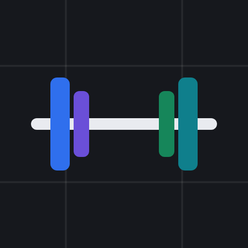

# Rep Sheet

A mobile-first workout logger that runs on your own Google account. You log lifts set by set on your phone, and every set lands as a row in a Google Sheet that you own. There's no server, no app store and no subscription: the app is a Google Apps Script web app bound to the Sheet.

<p align="center"></p>

```
apps-script/      Apps Script project (pushed with clasp)
  Code.js         server: reads/writes the Sheet
  Index.html      the phone UI
  appsscript.json manifest (time zone, web app access = only you)
assets/           app icon (SVG source + PNG)
main.py           load an exported log with pandas + progression summary
Makefile          clasp create / push / deploy
```

## Get the tools

You need git, make, Python 3, Node.js 20+ and [clasp](https://github.com/google/clasp) (Google's command-line tool for Apps Script). [uv](https://docs.astral.sh/uv/) is only needed for the optional analysis script.

**macOS**

```sh
xcode-select --install            # git, make, python3 (skip if already installed)
brew install node uv              # needs Homebrew: https://brew.sh
npm install -g @google/clasp
```

**Linux (Debian/Ubuntu)**

```sh
sudo apt install git make python3
# Node 20+: the distro package is often older, so use https://nodejs.org or nvm
npm install -g @google/clasp
curl -LsSf https://astral.sh/uv/install.sh | sh   # optional
```

**Windows:** use [WSL](https://learn.microsoft.com/windows/wsl/install) and follow the Linux steps.

Check with `node --version` (20 or later) and `clasp --version`.

## Setup (one time)

1. Clone the repo and `cd` into it.
2. Set your time zone in [apps-script/appsscript.json](apps-script/appsscript.json) (`timeZone`, an [IANA name](https://en.wikipedia.org/wiki/List_of_tz_database_time_zones) such as `Europe/London`). Dates are recorded in this zone.
3. Optional: change the starting program (`DEFAULT_CONFIG`) or units (`DEFAULT_UNIT`) in [apps-script/Code.js](apps-script/Code.js). The program is easy to change later from the Sheet too.
4. Turn on the Apps Script API for your Google account: https://script.google.com/home/usersettings
5. `clasp login`. This opens a browser; sign in and allow access.
6. `make create` creates a Google Sheet called **Rep Sheet** in your Drive with the script bound to it. It writes `.clasp.json`, which is gitignored because it identifies your project.
7. `make push`, then `clasp open-script`. In the editor, pick **setup** in the function dropdown and click **Run**. Google asks you to grant access to the spreadsheet. Because this is your own unpublished script, it shows "Google hasn't verified this app": choose **Advanced → Go to Rep Sheet**. This creates the `Log` and `Config` tabs.
8. `make deploy` prints the web app URL (it saves the deployment id in `.deployment-id`, also gitignored).
9. Open that URL on your phone while signed in to the same Google account, then add it to your home screen (Android Chrome: **⋮ → Add to Home screen**; iPhone Safari: **Share → Add to Home Screen**).

Later code changes only need `make deploy`. The URL stays the same. `make open` opens the Sheet.

The web app runs as you and only you can open it. Nothing leaves your Google account.

## Using it

Pick the workout, tap the exercise, adjust weight and reps, then tap **Log set**. Weight and reps carry over between sets. When you pick an exercise, they're prefilled from the previous session, and that session's sets appear as "Last time". Tap ✕ twice to delete a set.

- **Checklist:** each exercise button shows `2/4` while in progress and ✓ once you match last session's set count (3 if there's no history). You can keep logging past it. An outline marks the next unstarted exercise.
- **Plate helper:** on barbell lifts, tap a plate to add a pair, or **Bar** to reset. The line below shows the load per side.
- **Timer:** above the Log button, **Rest** counts up from your last set (tap to restart) and **Session** from this workout's first set. It shows only for today, and hides 30 min after the last set.
- **Calendar / late entries:** tap the date at the top to open a month view. Dots mark days you trained, colored by workout type. Tap a past day to view or backfill it; the date turns amber when it isn't today.
- **Bad signal:** sets are queued on the phone and retried automatically. Rows that are still saving show faded. A failed row says so; tap it to retry.
- **Bodyweight moves:** log the added weight (use 0 for plain bodyweight).
- **RPE / note:** optional, per set, under "+ RPE / note".
- **Dry run:** add `?dry=1` to the app URL to practice. Everything works, but nothing is saved, and the sets disappear on reload.

## Customizing

- **Workout types and exercises:** edit the `Config` tab. Each column is a workout type (row 1 holds the name) and the cells below are its exercises. Add a column to add a type. The changes show up when you reload the app, with no deploy needed. To log a one-off exercise, use "+ Other".
  - Name exercises movement first, with the variant in parentheses, e.g. `Bench Press (Incline)` or `Leg Curl (Cable)`.
  - **Renaming an exercise splits its history.** Also run find-and-replace on the `Log` tab.
  - Each day gets its own color: Upper A/B blue/violet, Lower A/B green/teal, and any extra types get orange or pink.
- **Plates / barbell lifts:** `PLATES` (bar and plate sizes) and `BARBELL` (which names count as barbell lifts) in [apps-script/Index.html](apps-script/Index.html).
- **Units / step size:** `DEFAULT_UNIT` in [apps-script/Code.js](apps-script/Code.js) and `STEP` in [apps-script/Index.html](apps-script/Index.html). Each row stores its own unit, so switching later won't corrupt old data.
- **Name / icon:** `APP_NAME` and `ICON_URL` in [apps-script/Code.js](apps-script/Code.js). The icon must be a public https URL ending in `.png` (Chrome on Android uses it for the home-screen icon). If you change it, remove the home-screen shortcut and add it again.
- **New fields:** add the name at the **end** of `LOG_COLUMNS` and a matching header in the Sheet. Never reorder or rename existing columns.

## Data model

The `Log` tab is tidy: **one row per set**. The app only appends and deletes rows.

| column | meaning |
|---|---|
| `session_date` | date of the workout (yyyy-mm-dd). You set it, so backfilled entries land on the right day |
| `workout_type` | e.g. `Upper A` |
| `exercise` | name, from Config or typed |
| `set_number` | 1-based within that exercise and session |
| `weight`, `unit` | load and `lb`/`kg` |
| `reps` | integer |
| `rpe`, `notes` | optional |
| `logged_at` | phone clock when the set was entered. Use it for ordering within a session, not as "workout time" |
| `session_id` | `<session_date>_<type-slug>`, groups one workout |
| `set_id` | UUID, so retries never double-log |

You can hand-edit typos in the Sheet. Keep the date and number columns as real dates and numbers.

To bring in history from elsewhere, paste rows into `Log` with `session_id` as `<session_date>_<type-slug>` (e.g. `2026-01-05_upper-a`), any unique text in `set_id`, and `logged_at` left blank.

## Analysis

Export the `Log` tab (**File → Download → CSV**) to `data/log.csv` (this folder is gitignored), then run:

```sh
uv run main.py data/log.csv
```

`load_log()` returns a typed DataFrame with `weight_lb`, `volume_lb` and `e1rm_lb` (Epley, blank above 12 reps). `progression()` gives a per-exercise, per-session summary. For a live pull without downloading, share the Sheet as "anyone with the link can view" and pass
`https://docs.google.com/spreadsheets/d/<SHEET_ID>/export?format=csv&gid=<LOG_TAB_GID>` instead. Note that this makes the data readable to anyone who has the link.

## Troubleshooting

- **"Sorry, unable to open the file" or saves fail on the phone:** this usually means the browser is signed in to several Google accounts. Open the URL in a browser profile (or private tab) signed in to only the account that owns the script.
- **Wrong day/time:** the time zone is set in [apps-script/appsscript.json](apps-script/appsscript.json). Change it and run `make deploy`.
- **`make create` says the API is disabled:** turn it on at https://script.google.com/home/usersettings, wait a minute, and try again.
- **`clasp` logged in to the wrong account:** `clasp logout`, then `clasp login`.
